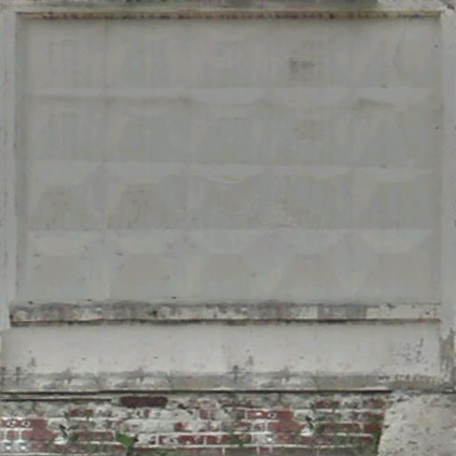

# TASK-ASSET-01 — проверка выбранного ПО-2

Первичная проверка: интеграция была остановлена из-за отсутствия рельефа в исходнике. После этого пользователь разрешил изготовить настоящий рельеф при условии проверки оптимизации. Результат доработки описан в [отчёте интеграции](material-previews/po2/README.md). Ниже сохранены исходные выводы проверки архива.

## Проверенный источник

Ранее выбранный ассет найден в первоначальном задании очереди 3: **Post-soviet fence PO-2 and grate**, автор Mixazzz, [OpenGameArt](https://opengameart.org/content/post-soviet-fence-po-2-and-grate). На странице указана CC0; автор отдельно подтверждает передачу модели в общественное достояние.

Скачан именно архив по ссылке страницы:
`https://opengameart.org/sites/default/files/post-soviet-fence-po-2-and-grate.zip`.

SHA256: `f907fb23b982d1ba327507075ffe59577463e89701a5601d317b1b326457437d`.

Архив содержит вложенный `source/zaborec.zip` с OBJ/MTL и тремя PNG. Это ограждение целого участка, а не отдельная подготовленная секция. В OBJ 3698 треугольников: 2634 с материалом `None`, 94 с `None_reshet.png`, 970 с `None_medicsubsta_zaborclear.png`.

## Препятствие

Требование плана — полноценная модель ПО-2 с характерным ромбовидным рельефом. У выбранного файла такой геометрии нет.

После объединения совпадающих позиций с точностью 0.001 у бетонной части получаются 97 отдельных компонентов, каждый по 10 треугольников. Это панели и основания. Представительная целая панель имеет **8 уникальных позиций вершин**, то есть геометрию плоской прямоугольной призмы. Её размеры в координатах исходника: X=3.22065, Y=3.321564, Z=0.187611. Единицы исходника не объявлены; считать эти числа метрами без проверки нельзя.

На исходной Color-текстуре читаются прямоугольная рамка, загрязнения и нижняя кирпичная полоса; характерный ромбовидный рисунок не читается. Normal/Height/Roughness-карт в архиве нет. Конвертация OBJ → GLB не добавит отсутствующий рельеф. Создание Normal из этой Color-карты также не даст геометрию ромбов.

Подробности проверки и позиции восьми вершин: [inspection.json](../assets/sources/opengameart/po2/inspection.json). Исходник сохранён рядом, включая исходный архив и распакованный OBJ/MTL, чтобы результат можно было проверить независимо.

## Существующий путь интеграции

Глобальный забор сейчас создаётся в `app/static/js/lobby3d.js`: общие `fenceGeo`/`fenceMat`, один `InstancedMesh` на чанк; обновление матриц, выбор и предпросмотр уже реализованы. В сохранении остаётся `type: 'fence'`. Поэтому интеграция пригодной секции не требует новой схемы хранения или отдельного объекта отрисовки для каждой секции.

В подлокациях уже существует загрузчик GLB и каталог вариантов, однако задача плана относится прежде всего к глобальной карте. Новый параллельный загрузчик и изменения подлокаций не создавались. Инструмент линии из TASK-GM-05 не начинался.

## Что проверено и что не выполнено

Проверены источник, лицензия на странице, состав обоих ZIP, MTL, материалы граней, количество треугольников, связные компоненты бетонной части, координаты и исходная текстура. Программные тесты игрового поведения не запускались: рабочий код не изменён. Игровые кадры, FPS, освещение модели, повороты/окончания и проверки сохранения пока не выполнялись — модель не интегрирована.

Добавлены только исходники в `assets/sources/opengameart/po2/` и этот отчёт.

## Требуемое решение

Возможны два дальнейших пути: согласовать моделирование настоящего ромбовидного рельефа с использованием выбранного материала либо предоставить/согласовать другой исходник, где он уже есть. Первый путь — доработка модели, а не перенос готовой геометрии; второй заменяет ранее выбранный ассет. Автоматически ни один путь не выбран.

Остановка соответствует `AGENTS.md`, разделу «Перед работой»: «Если обнаружено серьёзное непредвиденное препятствие, остановись и сообщи о нём вместо самостоятельного расширения задачи». Здесь таким препятствием стало отсутствие в выбранном файле основного визуального признака из TASK-ASSET-01.
